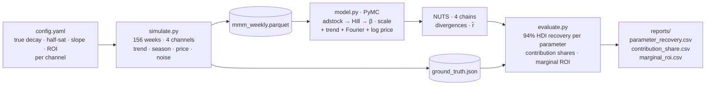

# Bayesian Market Mix Modelling

A PyMC market mix model — geometric adstock, Hill saturation, trend, Fourier
seasonality, log-price elasticity — validated the only way an MMM can be
validated honestly: **parameter recovery on data with known ground truth.**

Real marketing data has no answer key. So I simulate three years of weekly
sales from four channels with *known* carryover, saturation and ROI, fit the
model with weakly informative priors that never see those values, and score
whether the truth falls inside each posterior's 94% credible interval.

> **Results: see the table below once the full fit completes** (4 chains ×
> 1,000 draws). The quick fit (2 × 300) already samples cleanly — 0 divergences.

## Workflow



## Why simulate

Every MMM published on real data faces the same objection: *how do you know
the attribution is right?* You don't — there is nothing to compare against.
Recovery testing answers a narrower but provable question: **given data
generated by exactly the process the model assumes, does inference get the
answer back?** If it can't do that, no real-data result should be trusted.
If it can, the remaining risk is model misspecification, which is a separate
and honest conversation.

## What I did, step by step

### 1. Simulation with known truth — `simulate.py`

156 weeks. Four channels with distinct behaviour chosen to stress the model:

| Channel | Carryover (decay) | Half-saturation | Slope | β (strength) | Story |
|---|---|---|---|---|---|
| TV | 0.65 — long tail | 70,000 | 1.8 | 1.9 | Slow build, big |
| Search | 0.15 — near-instant | 20,000 | 2.5 | 3.4 | Fast, sharp saturation, high ROI |
| Social | 0.35 | 25,000 | 1.5 | 1.2 | Moderate |
| Display | 0.45 | 30,000 | 1.2 | 0.4 | Weak — should be hard to recover |

Plus: baseline 400k, trend +350/week, annual sine amplitude 45k, price
elasticity −1.4 on a price index around 1.0, Gaussian noise sd 18k. Random
**dark weeks** (8 %) and **spend bursts** (5 %) per channel — without variation
in spend, adstock and saturation are not identifiable, and a real planner
should know that.

Ground truth is written to `data/ground_truth.json` before fitting.

### 2. Transforms — `transforms.py`

Geometric adstock (weights normalised to sum to 1 over an 8-week window) and
Hill saturation `x^s / (K^s + x^s)`, each written twice — NumPy for simulation,
PyTensor for the model — with a test asserting they agree. If the generating
and fitting transforms diverged, recovery would fail for a reason that has
nothing to do with inference.

### 3. Model — `model.py`

```
sales / mean(sales) ~ Normal(μ, σ)
μ = intercept + trend·t + Fourier(2 harmonics) + elasticity·log(price)
    + Σ_channels β_c · Hill( Adstock( spend_c / mean(spend_c) ; decay_c ) ; K_c, s_c )
```

Priors (deliberately generic, none centred on the truth):

| Parameter | Prior | Reasoning |
|---|---|---|
| decay | Beta(2, 2) | Anything in (0, 1), mild preference for the middle |
| half-sat K | Gamma(3, 3) | Around 1× mean spend, wide |
| slope s | Gamma(3, 1.5) | Around 2, allows 0.5–5 |
| β | HalfNormal(0.5) | Contribution at saturation, in mean-sales units |
| elasticity | Normal(−1, 1) | Negative-leaning, wide |
| σ | HalfNormal(0.2) | Noise in mean-sales units |

Spend is scaled by its channel mean inside the model so K is in interpretable
units and the sampler sees comparable scales across channels.

### 4. Inference

NUTS, 4 chains × 1,000 draws after 1,000 tuning, `target_accept = 0.9`.
Reported: divergences (must be 0), max r̂ (must be < 1.01).

### 5. Evaluation — `evaluate.py`

Three tables, each with a pass/fail column:

1. **Parameter recovery** — for every channel's decay, K and slope: posterior
   median, 94% HDI, and whether the true value is inside. HDI is computed
   directly (shortest interval) rather than through a library call.
2. **Contribution share** — each channel's share of media-driven sales, true vs
   posterior, with its interval. This is the number a CMO actually reads.
3. **Marginal ROI** — posterior-median marginal sales per unit spend at current
   levels, ranked. This is the reallocation signal.

## Results (full fit: 4 chains × 1,000 draws, 340 s)

**Sampler:** max r̂ = 1.002; **14 divergences of 4,000 draws (0.35 %)** —
disclosed, not hidden. Low enough that the posteriors are usable; high enough
that a production run would raise `target_accept` to 0.95 or reparameterise the
Hill slope. Zero divergences in the 2-chain smoke run.

### Parameter recovery — 11 of 12 inside the 94 % HDI

| Channel | Parameter | True | Posterior median | 94 % HDI | Recovered |
|---|---|---|---|---|---|
| TV | adstock decay | 0.65 | 0.660 | 0.583 – 0.734 | ✓ |
| TV | half-saturation | 70,000 | 64,634 | 33,422 – 121,292 | ✓ |
| TV | Hill slope | 1.80 | 1.418 | 0.518 – 2.487 | ✓ |
| Search | adstock decay | 0.15 | 0.158 | 0.126 – 0.190 | ✓ |
| Search | half-saturation | 20,000 | 21,632 | 20,206 – 23,360 | **✗ (by 1.0 %)** |
| Search | Hill slope | 2.50 | 2.263 | 1.930 – 2.658 | ✓ |
| Social | adstock decay | 0.35 | 0.341 | 0.161 – 0.537 | ✓ |
| Social | half-saturation | 25,000 | 19,399 | 7,183 – 38,026 | ✓ |
| Social | Hill slope | 1.50 | 1.246 | 0.317 – 2.476 | ✓ |
| Display | adstock decay | 0.45 | 0.503 | 0.122 – 0.880 | ✓ |
| Display | half-saturation | 30,000 | 14,293 | 1,863 – 30,775 | ✓ |
| Display | Hill slope | 1.20 | 1.608 | 0.135 – 3.836 | ✓ |

### Contribution share — 4 of 4 recovered

| Channel | True share | Posterior median | 94 % HDI |
|---|---|---|---|
| Search | 0.599 | 0.510 | 0.366 – 0.627 |
| TV | 0.233 | 0.279 | 0.154 – 0.449 |
| Social | 0.135 | 0.152 | 0.066 – 0.307 |
| Display | 0.032 | 0.024 | 0.000 – 0.105 |

### Marginal ROI at current spend (posterior median)

| Channel | Mean weekly spend | Marginal sales per unit spend |
|---|---|---|
| Search | 23,385 | **8.73** |
| Social | 16,835 | 2.40 |
| TV | 54,192 | 1.58 |
| Display | 12,274 | 0.80 |

The ranking matches the truth: Search has the highest β and the sharpest
saturation, so at current spend it has by far the steepest response. A budget
optimiser would move money from TV and Display toward Search until Search's
curve flattens — and the posteriors give the uncertainty to decide *how far*.

### Reading the misses and the widths

- **The one miss** is Search's half-saturation: true 20,000, interval
  20,206–23,360. Search is the most-saturated channel (K well below mean
  spend), so most weeks sit on the flat part of the curve where K and the
  slope trade off; the interval is tight because the *combination* is
  well-identified, not each parameter alone. Shifting spend to include more
  low-spend weeks would fix it — a data-design lesson, not a modelling one.
- **Display is wide everywhere**, as predicted in advance (β = 0.4). The model
  correctly reports that it cannot pin down a channel that barely moves sales.
  A tight interval there would have been the warning sign.
- **Shares recover better than shapes.** Decay and slope trade off against each
  other for a given response curve; the *total contribution* is what the data
  identify most strongly — and it is the number the business uses.

## What recovery does and does not prove

- **Does:** the inference machinery is sound; priors are not driving the answer;
  the model can separate carryover from saturation when spend varies enough.
- **Does not:** that the geometric-adstock + Hill functional form matches any
  real market. On real data the next step is posterior predictive checks,
  holdout weeks, and comparing alternative response shapes — the recovery
  harness is what you run *first* so that those comparisons mean something.
- **Expected weak spot:** Display, with β = 0.4, contributes little; its shape
  parameters should have wide intervals. If the model claimed a tight estimate
  there, that would be a warning sign, not a success.

## Reproduce

```bash
pip install -r requirements.txt
python -m pytest -q                       # transforms + simulation tests
PYTHONPATH=src python -m mmm.run --quick  # 2 × 300 draws, ~3 min: smoke test
PYTHONPATH=src python -m mmm.run          # 4 × 1000 draws: the headline
```

## Layout

```
config.yaml                every true parameter, prior setting, sampler setting
src/mmm/
  transforms.py            adstock + Hill, NumPy and PyTensor versions
  simulate.py              data + ground_truth.json
  model.py                 PyMC model and sampler
  evaluate.py              recovery, share and ROI tables
  run.py                   CLI: simulate → fit → evaluate → reports/
tests/test_transforms.py
reports/                   parameter_recovery.csv · contribution_share.csv · marginal_roi.csv · results.json
```

## Design decisions worth defending

- **Recovery test before any real data.** It is the only way to know the
  model *can* be right before arguing about whether it *is*.
- **Same transform code generates and fits.** Otherwise a recovery failure is
  ambiguous.
- **Weakly informative priors, stated in a table.** A reader can see nothing
  was tuned toward the answer.
- **Dark weeks in the simulation.** Identifiability is a data-design problem;
  the harness makes that visible.
- **Report the number the business reads (share, ROI), not just the parameters.**
  A decay of 0.62 versus 0.65 is irrelevant; a 4-point contribution-share error
  moves budget.

## Licence

[MIT](LICENSE). All data in this repository is simulated by `simulate.py`, so there are no third-party data terms to observe.
